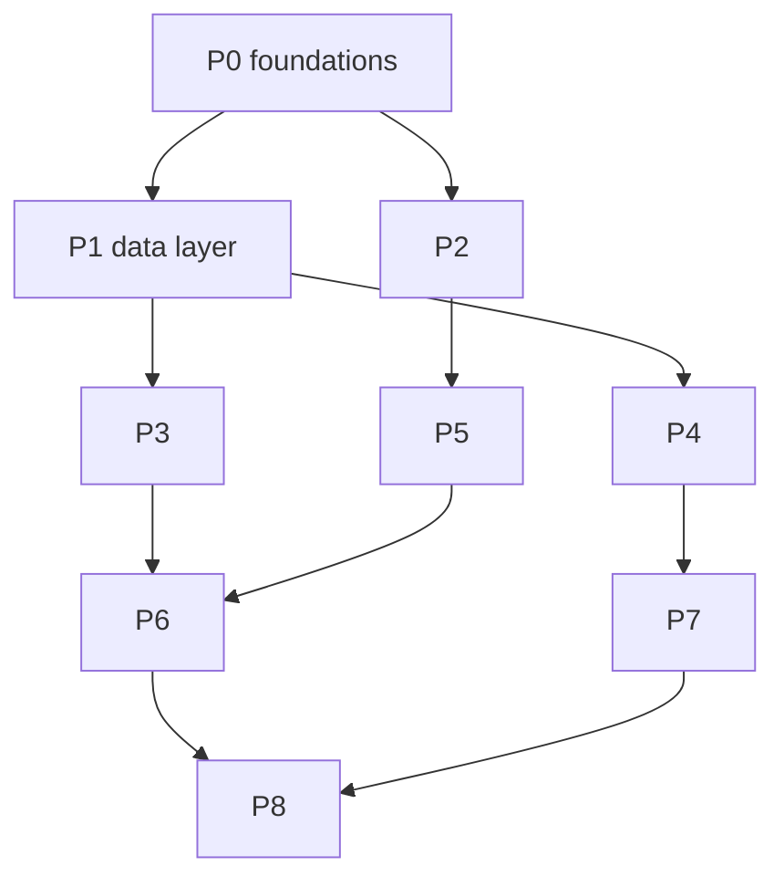

# Orchestrator README template

This is the template for `implementation-plan/phases/README.md` — the file handed to the orchestrating session. It will not have this skill loaded, so everything it needs must be inside it: no pointers back here.

**Substitute:** `<project name>`, `<plan-dir>`, `<M1…>` milestone names and their gates, the phase numbers and file names, the shared-file list, and the real commands. Delete any section the project genuinely does not have (e.g. §6's milestone table if there is only one milestone) — but never delete §1, §4 or §5.

Everything below the rule is the template.

---

# How to run the build — orchestrator instructions

Status: Draft. Updated: <date>.

**This file is a prompt.** Give it to the orchestrating agent — the one session that coordinates the build. Everything that session spawns is a **subagent**: builders, verifiers and fixers. This file says what to run, in what order, how many at a time, and how each phase gets verified before the next one starts. The phase files beside it are the work; this file is the schedule.

Read [folder-structure.md](../folder-structure.md) before spawning anything — every phase writes only inside the paths that document defines.

**Before anything runs, [SETUP-GATE.md](SETUP-GATE.md) must be closed by the human.** A subagent that hits a missing credential stops, guesses, or fakes it. The third case passes verification and costs the most.

---

## 1. Vocabulary (read this first, the numbers collide)

- **Milestone (<M1/M2/…>)** = a *product* delivery milestone. Several phases each.
- **Phase (P0–P<N>)** = a unit of work in this folder, sized so one subagent can own it end to end without touching another subagent's files.
- **Orchestrator** = you, the coordinating session. You spawn subagents; **you never build a phase yourself.**
- **Subagent** = anything you spawn. Builders write code, verifiers judge it, fixers close gaps. When this file says "agent" it means you; when it says "subagent" it means something you spawned.

The milestone-to-phase mapping is in §3.

**P0 and P1 are built in this chat, not by subagents.** Every other phase inherits them, so a mistake there multiplies by the number of phases that follow — you want a human reading that code. Subagents start at P2.

## 2. Dependency graph



## 3. Waves — what to run, and what runs together

Run waves strictly in order. A wave is the set of phases whose dependencies are now met — **it is not a set you must launch all at once.**

> ### Concurrency limit
> **Spawn two subagents at a time. Three only when the scope justifies it. Never more than three.**
>
> Three is allowed when all three phases are small and own completely separate trees. It is not allowed just because the wave is wide.
>
> The limit is not the machine. It is that you have to actually read what comes back: every extra subagent is another verification report to hold in context, another diff to merge, and another chance that two of them drifted in the same direction without noticing.

So a wide wave is worked through in **batches**. Finish and verify a batch before launching the next one.

| Wave | Phases ready | Run as | Batch order, and why |
|---|---|---|---|
| 1 | P0 | in this chat | Alone. It creates the tree everything else writes into |
| 2 | P1 | in this chat | Alone. It writes the whole schema in one migration |
| 3 | P2, P3, P4 | 2 batches | **P2 + P3** first — P6 needs both, so this is the long pole. Then **P4** |
| … | … | … | … |

Never start a wave until every phase in the previous wave reads `pass`. Within a wave, batches are ordered by **what they unblock**, so following the order shortens the critical path. If you reorder, reorder by that same rule and check §4.2 again.

**If you are shipping <M1> first:** keep the wave order and drop the phases belonging to later milestones. Most waves then collapse to a single batch of two.

| Phase | File | Milestone | Status |
|---|---|---|---|
| P0 | [phase-00-<name>.md](phase-00-<name>.md) | <M1> | not started |
| P1 | [phase-01-<name>.md](phase-01-<name>.md) | <M1> | not started |
| … | | | |

Update the Status column as phases move: `not started` → `building` → `verifying` → `pass`. This table is the only place the current state of the build is written down — if your context resets, it is what you read first.

## 4. Rules that make parallel safe

1. **Two subagents at a time, three at the absolute most.** See §3. One subagent owns one phase, start to finish.
2. **Exclusive ownership.** Every phase file lists `Owns (exclusive write)`. A subagent writes only there. Two phases in the same batch never own the same path — that is what makes the batch safe, so do not regroup phases without checking it.
3. **If a phase needs a change outside its paths, it stops and reports.** It does not edit another phase's file "just quickly". You decide: patch it yourself, or queue it for the owning phase.
4. **Shared files are append-only and few.** Only `<shared file 1>` and `<shared file 2>`. Append, never reorder or rewrite.
5. **No phase after P1 writes a migration.** P1 creates the whole schema in one revision, precisely so parallel subagents never race on a linear migration history. A genuinely missing column is an exception you approve, not a subagent's call.
6. **No phase edits a registration file.** P0 makes routers, job handlers and UI routes auto-discovered. If a subagent reports "I need to register X in `<entrypoint>`", **P0 is incomplete — fix P0 instead of accepting the edit.** Accepting it once guarantees two subagents will edit that file at the same time later.
7. **Exactly two commits per phase** — one build, one verification. Not one per task. A fix round is amended into the build commit, never added as a third. Templates in §5.
8. **Running three? Give each builder its own git worktree** and merge after verification. Ownership rules already prevent overlap; worktrees prevent surprises. Optional for a batch of two.
9. **Test data is synthetic and secrets stay out of the repo.** Fixtures carry a note saying they are synthetic. `.env.example` holds names only. A subagent that needs a real credential has hit the setup gate, not a coding problem — escalate.

## 5. The build → verify → fix loop

Per phase, in order. You are the orchestrator; everything below runs as a **subagent**.

**The verifier is never the subagent that wrote the code** — a builder reads its own plan as satisfied, because its context holds what it meant to do. A fresh subagent reading only the tree does not have that bias.

> ### Verification limit
> **At most two verification turns per phase. Exactly one fix round between them.**
>
> Verify → if gaps, fix once → verify again. If the second verification still reports gaps, **stop and escalate to the human.** No third verification, no second fix round.
>
> A gap that survives one focused fix round is almost never a coding mistake. It is a plan asking for something the code cannot give, or a contract item ambiguous enough that two subagents read it two ways. More rounds just burn context on the same disagreement.

### Step 0 — CI gate before verification

If the repo has a CI pipeline, run it (or its local equivalent: lint, types, boundary/import contracts, the full test suite) **before spawning the verifier**. It is cheap and it catches the whole class of failures that do not need a reasoning subagent to find. A verifier's turn is expensive and there are only two of them — do not spend one on a lint error.

### Step 1 — Build

Spawn one builder subagent per phase, up to the concurrency limit in §3, with this prompt:

```
You are building Phase <N> of <project name>.

Read, in this order:
  <plan-dir>/phases/phase-<NN>-<name>.md     your plan — every task in it is in scope
  <plan-dir>/folder-structure.md             where files go, naming, boundaries
  the PRD files linked in your phase file

Rules:
- Write only inside the paths under "Owns (exclusive write)" in your phase file.
  If you need a change outside them, STOP and report it — do not make the edit.
- Do not create database migrations. The schema already exists.
- Do not edit any registration file (app entrypoint, route table, handler registry).
  Registration is by convention; if something is not being discovered, report it.
- Every task's "done when" is a real check. Run it before you call the task done.
- Before finishing, run the commands in your phase file's "Verification contract"
  and record the results — you will need them in the commit message.

Commit: ONE commit for the whole phase, made when every task is done. Not one per task.

  Subject: P<N> <what this phase built, in plain words>
  Body:
    Tasks: <N>.1 … <N>.<k> — one line each, what was actually done
    Created: <paths>
    Edited:  <paths>
    Contract: <each command from the verification contract> → <result>

Report back: tasks completed, tasks not completed and why, files created vs edited,
the contract commands you ran with their output, and any change you needed outside
your owned paths.
```

### Step 2 — Verify (a different subagent, read-only) — **turn 1 of 2**

When the builder reports done and CI is green, spawn a **different** subagent:

```
You are verifying Phase <N>. You did not write this code. Assume nothing works.

Read <plan-dir>/phases/phase-<NN>-<name>.md and check the repository against its
"Verification contract" section, item by item.

Rules:
- Judge the CODE. Not the commit messages, not the builder's report, not the plan's intent.
- Run every command listed in the contract. Paste real output — never a summary you assume.
- A task that exists but is stubbed, hardcoded, or silently skipped is a GAP, not a pass.
- Check the negatives too: paths written outside the phase's "Owns" list, a migration that
  should not exist, a registration file that was edited.
- Do not fix anything. Do not write application code. Your only write is your report.

Write your report to <plan-dir>/phases/verification/phase-<NN>.md in this format:

  STATUS: pass | gaps

  CHECKED:
  <one line per contract item — the item, pass/fail, and evidence: file:line or command output>

  GAPS:
  <numbered. For each:
     what the plan requires
     what is actually there
     the exact file path
     the smallest change that would close it>
  <"none" if there are none.>

Then reply with STATUS and the gap count only.
```

### Step 3 — Fix (only if `gaps`) — **the one and only fix round**

Send the gap list back to the **original builder subagent** if it is still running — it keeps its context, so it is both cheapest and least likely to misread the plan. If it is gone, spawn a fresh fixer:

```
Phase <N> was verified and has gaps. Close them.

Read <plan-dir>/phases/verification/phase-<NN>.md — the GAPS list is your task list.
Read <plan-dir>/phases/phase-<NN>-<name>.md for the original plan.

Same rules as the build: write only inside your phase's owned paths, no migrations,
no edits to registration files, no edits outside your paths.

Fix only what the GAPS list names. Do not refactor anything else — a fix round that
touches unrelated code makes the second verification unreadable.

Commit: do NOT add a new commit. Amend your changes into the phase's existing build
commit so the final history stays at two commits per phase. Update that commit's body
to include the gaps you closed.

Report back: each gap, what you changed, and the check you ran to confirm it is closed.
```

Then run **Step 2 again with a new verifier subagent** on the updated tree. That is verification turn 2, and it is the last one.

### Step 4 — Commit the verification

Once a phase reads `pass`, make the second and final commit for that phase yourself:

```
P<N>.verify <pass | gaps closed after one fix round>

<k> contract items checked, <k> pass, <n> gaps <closed | escalated>.
Report: <plan-dir>/phases/verification/phase-<NN>.md
```

The final history is two commits per phase: what was built, and whether it held up.

### Step 5 — Stop conditions

- `pass` at either verification turn → mark the phase `pass` in §3's table, commit the verification, continue the batch.
- **`gaps` at verification turn 2 → stop and escalate to the human.** Report which contract items did not close, what the verifier says is actually there, and whether you think the plan or the code is wrong.
- A builder reporting "I need to write outside my paths" → **escalate immediately, before it writes anything.** That is a planning bug and it will collide with a parallel subagent.
- A builder that fails to finish at all → do not respawn it blindly. Read its report first; a phase that cannot be built usually has a dependency that is not actually `pass`.

### Choosing subagent types

| Role | Type | Notes |
|---|---|---|
| Builder | general-purpose (write access) | One per phase. |
| Verifier | general-purpose, instructed to write only its report | A strictly read-only agent type cannot write the report file. |
| Fixer | the original builder, else general-purpose | Prefer the original — it keeps its context. |

Count every spawn against the limit in §3. Two builders plus their two verifiers is four spawns, but only two run at once — verification happens after its builder reports, not alongside it.

## 6. Milestone gates

A milestone is done when every phase in it reads `pass` **and** the acceptance scenarios from the PRD run green. Phases passing is not the milestone.

| Milestone | Phases | Done when |
|---|---|---|
| <M1> — <name> | P0–P<n> | <the end-to-end scenario, in user terms> |
| <M2> — <name> | P<n>–P<n> | <…> |

<List here any gate that no phase closes — compliance review, vendor verification, a privacy control deferred out of scope — and what must not happen until it closes. These are easy to lose, because every phase can read `pass` while they are still open.>

## 7. When things go sideways

| Situation | Do this |
|---|---|
| **A subagent wants to change the plan** ("this would be cleaner as…") | It stops and reports; it does not change the plan. You decide. If the change is right, **edit the phase file first**, then let it build — otherwise the verifier checks the code against a contract nobody updated and reports a false gap. |
| **A phase is blocked mid-run** (missing credential, an upstream dependency that is not really `pass`, an ambiguous PRD rule) | Do not let it guess. Have it report and stop. Missing credential → back to the setup gate. Upstream not really done → re-verify that phase before restarting this one. Ambiguous rule → a human decides and the phase file is updated to record the decision. |
| **Your context resets mid-build** | Read §3's status table, then `git log --oneline` — two commits per phase makes the true state readable in one screen. A phase with a build commit and no verification commit was interrupted between the two; re-verify it rather than rebuilding it. |
| **Two phases turn out to want the same file** | Planning bug. Stop both. Either move the file into P0 as shared and append-only, or give it to one phase and make the other read it. Do not let them take turns. |
| **A verifier and a builder disagree about what a contract item means** | The contract item is ambiguous. That is a plan defect: rewrite the item, then re-verify. Do not arbitrate between two subagents' readings. |
| **A phase's contract passes but the feature is obviously wrong** | The contract is too weak. Fix the contract in the phase file, then run a verification turn against the new one. Note it — the same weakness is probably in sibling phases. |
